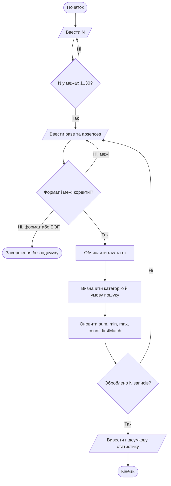

# Лабораторна робота № 2 — Потокова обробка даних

**Дисципліна:** Основи програмування  
**Мова:** C++17  
**Варіант:** 5 — «Скоригований результат за пропуски»

> Програма послідовно обробляє `N` записів, перевіряє вхідні дані та обчислює статистику без збереження всієї історії записів у масиві чи контейнері.

## 1. Призначення програми

Для кожного запису програма отримує початкову кількість балів і кількість пропусків, після чого віднімає штраф за пропуски. Скоригований показник не може бути від'ємним. Далі програма визначає статус за порогом 50 балів і накопичує загальну статистику за всіма прийнятими записами.

## 2. Вхідні дані та обмеження

| Поле | Тип | Одиниця | Допустимі значення |
|---|---|---|---:|
| `N` | `int` | кількість записів | 1–30 |
| `base` | `int` | початкові бали | 0–100 |
| `absences` | `int` | кількість пропусків | 0–10 |
| `m` | `int` | скориговані бали | 0–100 |

Кожен запис приймається лише тоді, коли обидва поля прочитані як цілі числа та перебувають у своїх межах. Якщо числове значення виходить за межі, повторно вводиться **весь поточний запис**. Така спроба не змінює статистику та не займає номер запису. Помилка формату або EOF завершує програму без повного підсумку.

## 3. Формула та правила класифікації

Спочатку обчислюється необмежений результат:

```cpp
int raw = base - 3 * absences;
```

Потім застосовується нижня межа нуль звичайним `if`:

```cpp
if (raw < 0) {
    m = 0;
} else {
    m = raw;
}
```

| Умова | Категорія | Пошук |
|---|---|---|
| `m >= 50` | поріг досягнуто | так |
| `m < 50` | нижче порогу | ні |

Умова пошуку: **`m >= 50`**. Вона збігається з правилом категоризації.

## 4. Що обчислює програма

Після обробки всіх `N` коректних записів виводяться:

- сума скоригованих показників;
- дробове середнє `sum / N`;
- мінімальне та максимальне значення з номерами їхніх перших входжень;
- кількість записів, що відповідають умові пошуку;
- номер першого збігу або повідомлення «немає».

Мінімум і максимум ініціалізуються першим коректним записом. Для збереження першого номера при нічиїй використовуються строгі порівняння `<` та `>`.

## 5. Алгоритм роботи



## 6. Декомпозиція на функції

| Функція | Призначення |
|---|---|
| `calculateM(base, absences)` | Обчислює скоригований показник і обмежує його нулем. |
| `categoryFor(m)` | Повертає текстову категорію. |
| `isSearchMatch(m)` | Перевіряє умову пошуку `m >= 50`. |
| `readValidRecord(recordNumber, base, absences)` | Зчитує поля й повторює запис у разі помилки діапазону. |
| `main()` | Керує введенням `N`, потоком записів, статистикою та підсумком. |

У коді є `assert` для чистих функцій `calculateM` та `isSearchMatch`.

### Ручна траса за контрольними даними варіанта

Вхідні записи: `(74, 4)`, `(40, 2)`, `(50, 0)`.

| Прийнятий запис | Вхідні поля | `m` | Категорія / пошук | Сума | Min (№) | Max (№) | Count | FirstMatch |
|---:|---|---:|---|---:|---:|---:|---:|---:|
| 1 | 74, 4 | 62 | поріг досягнуто / так | 62 | 62 (1) | 62 (1) | 1 | 1 |
| 2 | 40, 2 | 34 | нижче порогу / ні | 96 | 34 (2) | 62 (1) | 1 | 1 |
| 3 | 50, 0 | 50 | поріг досягнуто / так | 146 | 34 (2) | 62 (1) | 2 | 1 |

Середнє після трьох записів: `146 / 3 = 48.6667` (відображення за стандартним форматом `double`).

## 7. Збірка та запуск

### Visual Studio

1. Створити консольний проєкт C++.
2. Додати наявний файл `src/LR2_Variant5.cpp` до проєкту.
3. Установити стандарт C++17 або новіший.
4. Зібрати проєкт і запустити його через `Ctrl+F5` (або `F5` для налагодження).

### Компілятор g++

```bash
g++ -std=c++17 -Wall -Wextra -pedantic src/LR2_Variant5.cpp -o LR2_Variant5
```

Запуск у Linux/macOS:

```bash
./LR2_Variant5
```

Запуск у Windows:

```powershell
.\LR2_Variant5.exe
```

Після запуску введіть `N`, а потім по одному запису у форматі `base absences`.

## 8. Тестування

Підготовлено десять сценаріїв відповідно до методички: один запис; стандартний набір; межі, пороги й `N=30`; нічия min/max; відсутність збігів; усі записи зі збігом; перший збіг до завершення потоку; повтор після недопустимого значення; помилка формату/EOF; regression-тест дефекту.

Основну програму та окремі D1-проєкти скомпільовано з прапорцями `-std=c++17 -Wall -Wextra -pedantic` у GNU g++ 14.2.0. Сценарії 1–9 пройшли локальну перевірку; дефектна D1-версія відтворила очікувану помилку, а виправлена пройшла три regression-тести. Перевірка debugger у Visual Studio та скриншоти до цього пакета не входять — їх потрібно додати після власного запуску.

Детальні вхідні дані, очікувані значення та статус локальної перевірки: [`tests/TEST_CASES.md`](tests/TEST_CASES.md).

## 9. Призначений дефект D1

Для варіанта 5 за правилом методички призначено **D1 — невключний поріг у лічильнику**. Початкова помилкова умова `value > threshold` не зараховує значення, рівне порогу. Виправлена умова — `value >= threshold`.

Для відтворення й виправлення створено окремі тестові консольні проєкти, щоб не змішувати їх із головною програмою:

- `D1_Debug/01_Buggy/main.cpp` — дефектна реалізація та failing test;
- `D1_Debug/02_Fixed/main.cpp` — виправлена реалізація й три regression-перевірки;
- [`D1_Debug/BUG_REPORT_D1.md`](D1_Debug/BUG_REPORT_D1.md) — опис дефекту.

Компіляція окремого D1-проєкту:

```bash
g++ -std=c++17 -Wall -Wextra -pedantic D1_Debug/01_Buggy/main.cpp -o d1_buggy
./d1_buggy
```

Перший запуск має завершитися з кодом помилки та показати `expected=1, actual=0` — це навмисний failing test. Після цього зберіть виправлену версію:

```bash
g++ -std=c++17 -Wall -Wextra -pedantic D1_Debug/02_Fixed/main.cpp -o d1_fixed
./d1_fixed
```
## 10. Структура папки

```text
LR2/
├── README.md
├── src/
│   └── LR2_Variant5.cpp
├── tests/
│   └── TEST_CASES.md
└── D1_Debug/
    ├── BUG_REPORT_D1.md
    ├── 01_Buggy/
    │   └── main.cpp
    └── 02_Fixed/
        └── main.cpp
```
## 11. Декларація використання ШІ

Під час підготовки цього GitHub-пакета використовувався ChatGPT для оформлення README та підготовки тестової документації й матеріалів D1. Основну програму та окремі D1-версії було скомпільовано й перевірено локально командним рядком; перевірка Visual Studio debugger.
